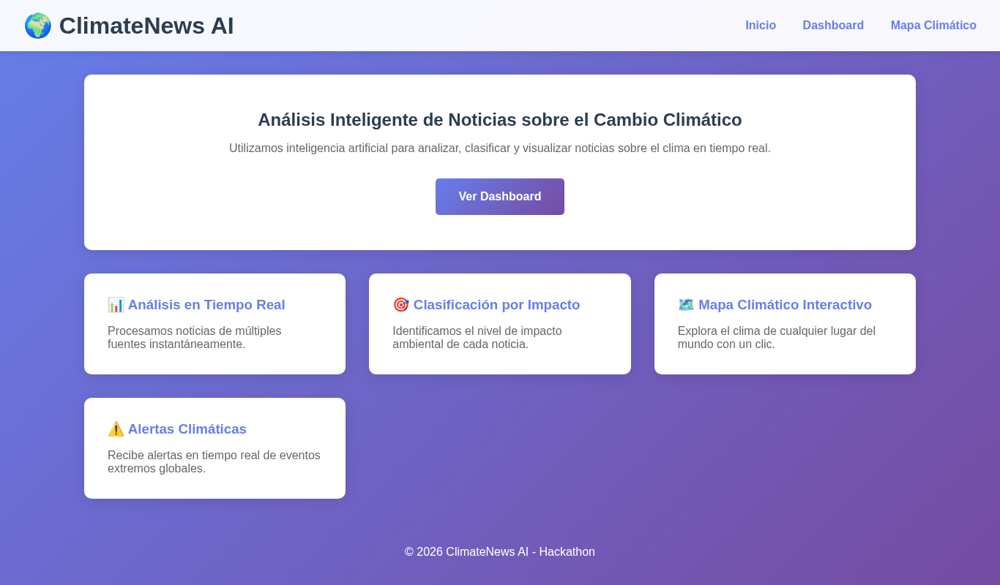
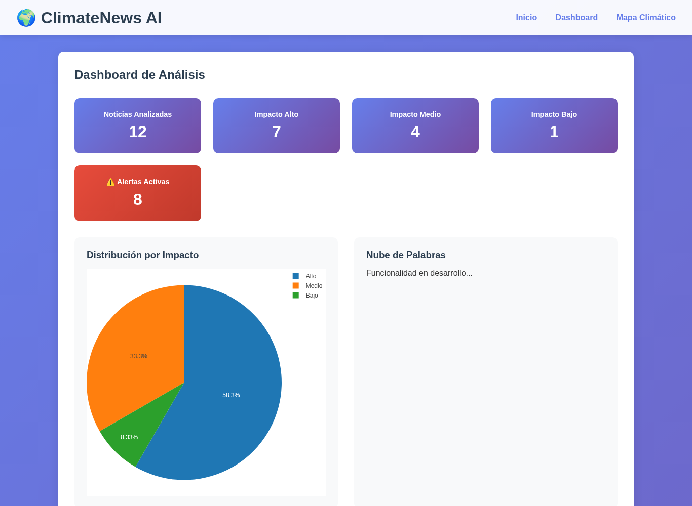
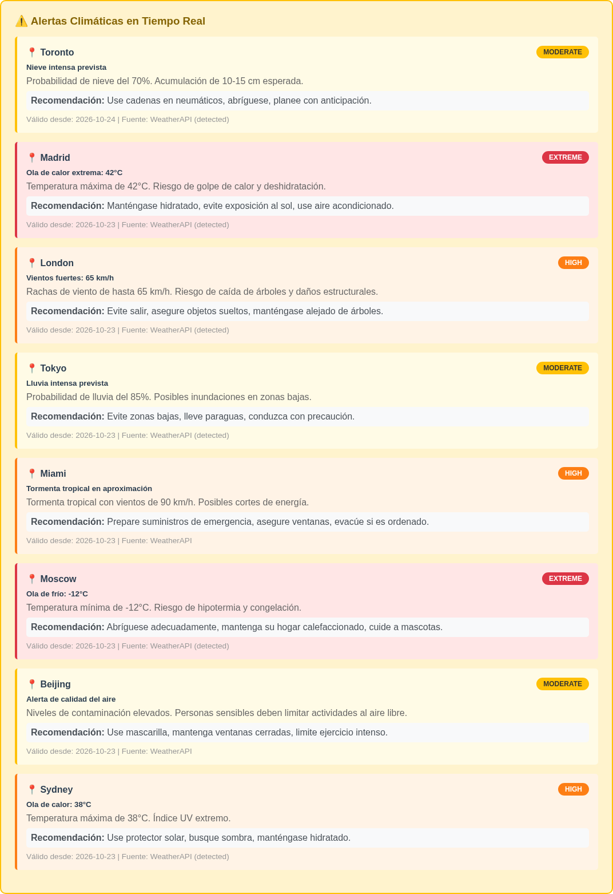
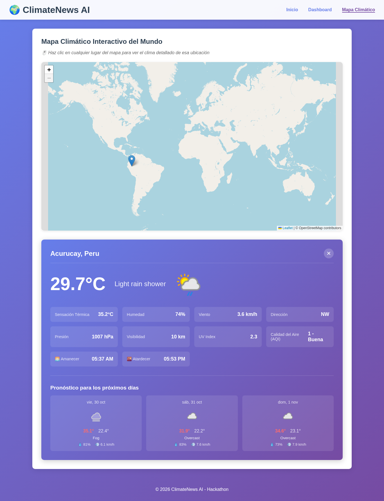

# 🌍 ClimateNews AI

> Plataforma web para entender el cambio climático: noticias clasificadas por impacto, alertas climáticas de todo el mundo y un mapa interactivo con el clima en tiempo real.

**Autor:** Alexander Nicolás Arenas Lynch
**Proyecto:** Hackathon - Cambio Climático (Python Pro, M10L2)



---

## 📝 Descripción del proyecto

### ¿Qué problema resuelve?

Cada día se publican miles de noticias sobre el clima. Es difícil saber cuáles son relevantes, distinguir información fiable del sensacionalismo y entender qué está pasando en el mundo. **ClimateNews AI** reúne y organiza esa información de forma clara, visual y basada en datos.

### Finalidad

- Informar y concienciar sobre el cambio climático con datos claros.
- Mostrar de un vistazo qué noticias tienen mayor **impacto ambiental**.
- Avisar de **eventos climáticos extremos** (olas de calor, frío extremo, tormentas, contaminación).
- Permitir consultar el **clima en tiempo real de cualquier lugar del mundo** con un clic.

### Posibles usos

- 🎓 **Educación:** apoyo en clases de ciencias y medio ambiente.
- 📰 **Periodismo y divulgación:** panorama rápido de las noticias climáticas más importantes.
- 🏙️ **Ciudadanos:** revisar alertas y el pronóstico antes de viajar o salir.
- 🏛️ **Organizaciones y ONG:** seguimiento de eventos climáticos extremos a nivel global.

---

## 🚀 Funciones y características

### 📊 Dashboard de análisis
- Contador de noticias analizadas y alertas activas.
- Clasificación de noticias por **impacto ambiental**: alto, medio y bajo.
- Gráfico circular interactivo (Plotly) con la distribución por impacto.
- Lista de las últimas noticias con su fuente, fecha y nivel de impacto.

### ⚠️ Alertas climáticas en tiempo real
- Alertas de ciudades de todo el mundo (Toronto, Madrid, Londres, Tokio, Miami, Moscú, Pekín, Sídney...).
- Nivel de severidad con colores: **MODERATE**, **HIGH**, **EXTREME**.
- **Recomendación** práctica para cada alerta (qué hacer para protegerse).
- Detección de condiciones extremas: olas de calor, frío, vientos fuertes, lluvia intensa y mala calidad del aire.

### 🗺️ Mapa climático interactivo
- Mapa mundial (Leaflet + OpenStreetMap): haz clic en cualquier punto para ver su clima.
- Datos en tiempo real vía **WeatherAPI**: temperatura, sensación térmica, humedad, viento y dirección, presión, visibilidad, índice UV, **calidad del aire (AQI)**, amanecer y atardecer.
- **Pronóstico de los próximos días** con máximas, mínimas, probabilidad de lluvia y viento.

### 🔌 API REST propia
| Endpoint | Descripción |
|---|---|
| `GET /api/news` | Últimas 20 noticias |
| `GET /api/stats` | Número de noticias por nivel de impacto |
| `GET /api/weather-alerts` | Alertas climáticas de los últimos 7 días |
| `GET /api/weather-alerts/stats` | Alertas por severidad |
| `GET /api/weather/current?lat=&lon=` o `?city=` | Clima actual |
| `GET /api/weather/forecast?lat=&lon=&days=` | Pronóstico (máx. 7 días) |

### 🛠️ Tecnologías
- **Backend:** Python, Flask, SQLite
- **Frontend:** HTML, CSS, JavaScript, Plotly.js, Leaflet
- **Datos externos:** [WeatherAPI](https://www.weatherapi.com/)
- **Otras:** Requests, python-dotenv

### Arquitectura

```
Navegador (HTML + Plotly + Leaflet)
        │  fetch()
        ▼
Flask (app.py) ── /api/news, /api/stats, /api/weather-alerts ──► SQLite (climate_news.db)
        │
        └── /api/weather/current, /api/weather/forecast ──► WeatherAPI
```

---

## 🎬 Demostración

### Página principal


### Dashboard de análisis
Estadísticas y distribución de noticias por impacto ambiental.



### Alertas climáticas en tiempo real


### Mapa climático interactivo
Al hacer clic en el mapa (en este ejemplo, en Perú) se muestra el clima actual y el pronóstico.



---

## 📦 Instalación y uso

**Requisitos:** Python 3.10+ y una API key gratuita de [WeatherAPI](https://www.weatherapi.com/).

```bash
# 1. Clonar el repositorio
git clone https://github.com/NIcoAL14/M10L2.git
cd M10L2

# 2. Crear y activar el entorno virtual
python3 -m venv venv
source venv/bin/activate        # En Windows: venv\Scripts\activate

# 3. Instalar dependencias
pip install -r requirements.txt

# 4. Configurar la API key
cp .env.example .env
# Edita .env y escribe: WEATHER_API_KEY=tu_api_key

# 5. Cargar datos de ejemplo (noticias y alertas)
python3 populate_data.py

# 6. Ejecutar la aplicación
python3 app.py
```

La app se abre automáticamente en `http://127.0.0.1:5001/`. Otros dispositivos de la misma red Wi‑Fi pueden entrar con la IP que aparece en la terminal.

**Cómo usarla:**
1. **Inicio:** resumen de lo que ofrece la plataforma.
2. **Dashboard:** revisa las estadísticas, alertas y últimas noticias.
3. **Mapa Climático:** haz clic en cualquier lugar del mundo para ver su clima y pronóstico.

> Sin API key la app funciona, pero el mapa no podrá mostrar el clima en tiempo real.

---

## 💬 Comentarios y participación

¡Tu opinión ayuda a mejorar el proyecto! Puedes participar así:

- 🐛 **Reportar errores o proponer ideas:** abre un [Issue en GitHub](https://github.com/NIcoAL14/M10L2/issues) explicando qué pasó o qué te gustaría ver.
- 🔧 **Contribuir con código:** haz un *fork*, crea una rama con tu mejora y envía un *Pull Request*.
- ⭐ **Apoyar el proyecto:** dale una estrella al repositorio si te resultó útil.
- 🗣️ **Durante la presentación:** comparte tus comentarios y preguntas directamente conmigo.

### Próximas mejoras
- Nube de palabras con los temas más frecuentes.
- Obtención automática de noticias desde fuentes reales (NewsAPI / RSS).
- Clasificación automática por impacto con NLP (NLTK / spaCy).
- Generador de resúmenes automáticos de noticias.
- Búsqueda por temas y palabras clave.

---

## 🏁 Conclusión

El cambio climático es uno de los mayores retos de nuestra generación, y para actuar primero hay que **entenderlo**. ClimateNews AI convierte una avalancha de información en algo claro y útil: qué noticias importan, dónde hay riesgos climáticos ahora mismo y cómo está el clima en cualquier parte del planeta.

Su valor está en ayudar a estudiantes, periodistas, ciudadanos y organizaciones a **tomar decisiones informadas** y a mantenerse conscientes del impacto del clima en el mundo.

**¡Gracias por tu atención! ¿Tienes alguna pregunta sobre el proyecto?** 🙌

---

📄 Licencia: MIT
